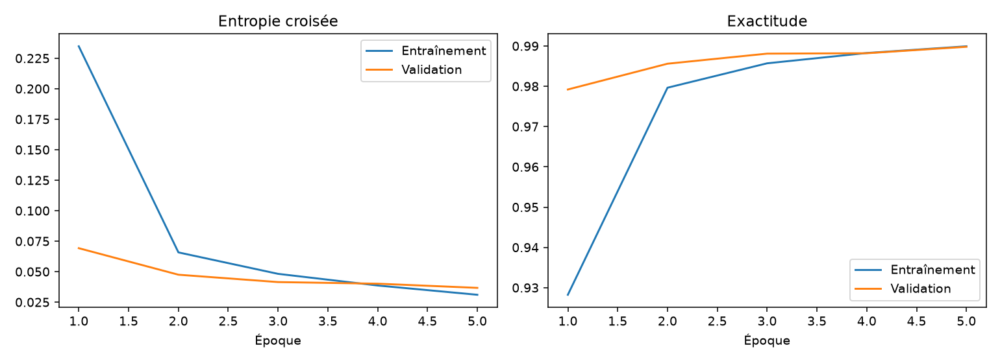
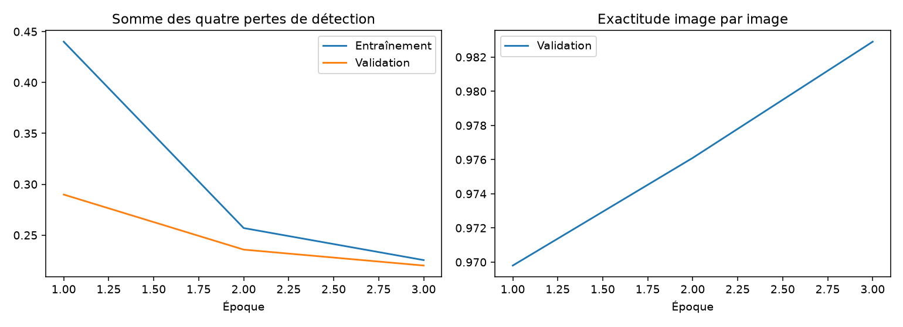
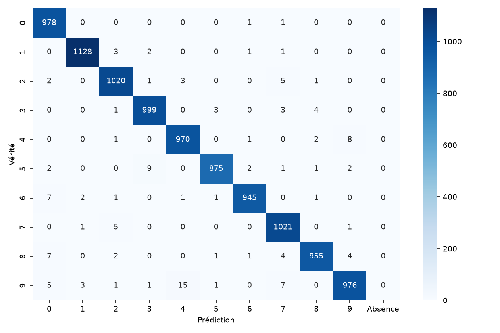
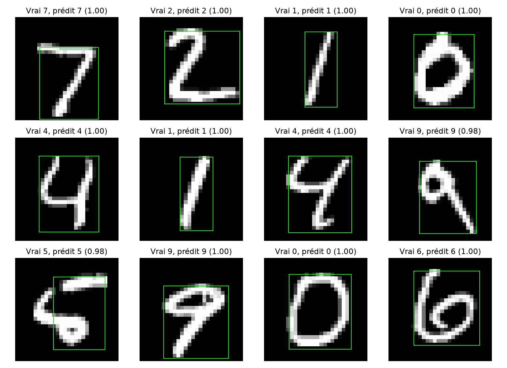
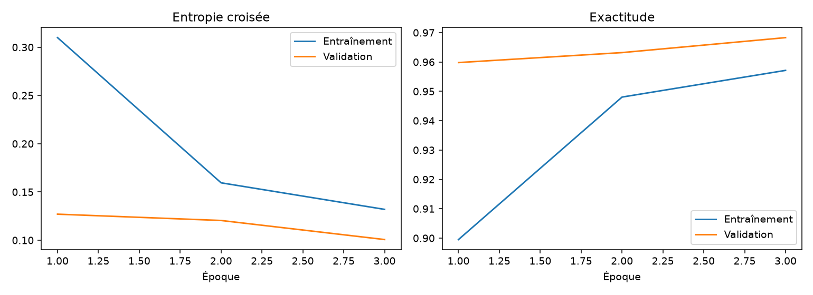
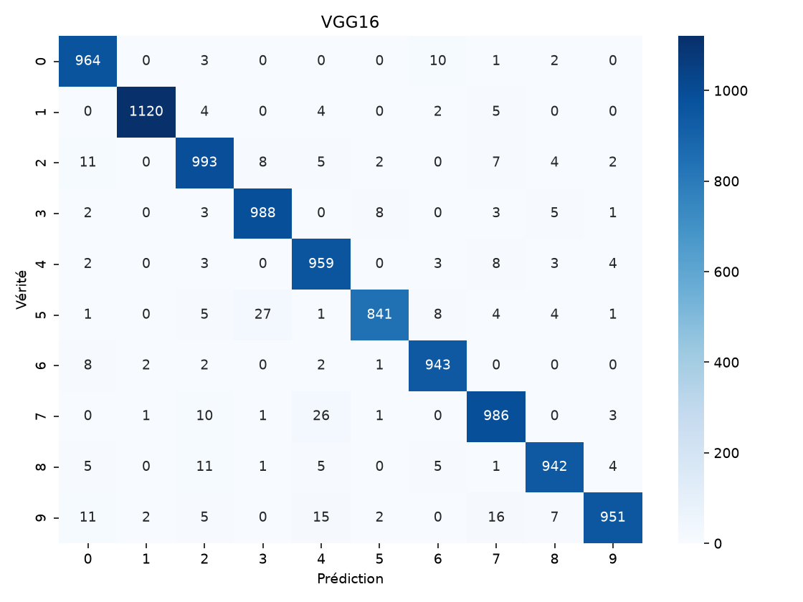
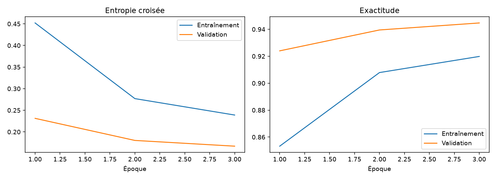
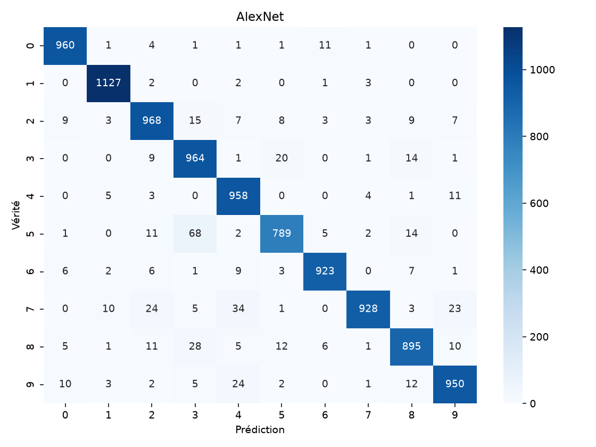
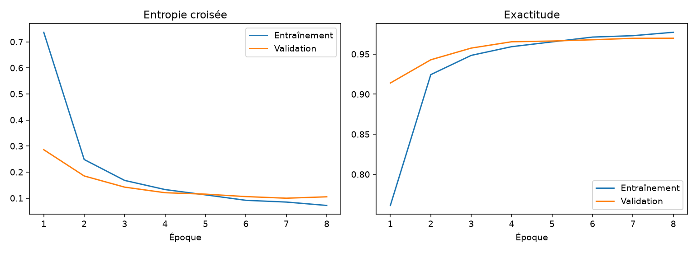
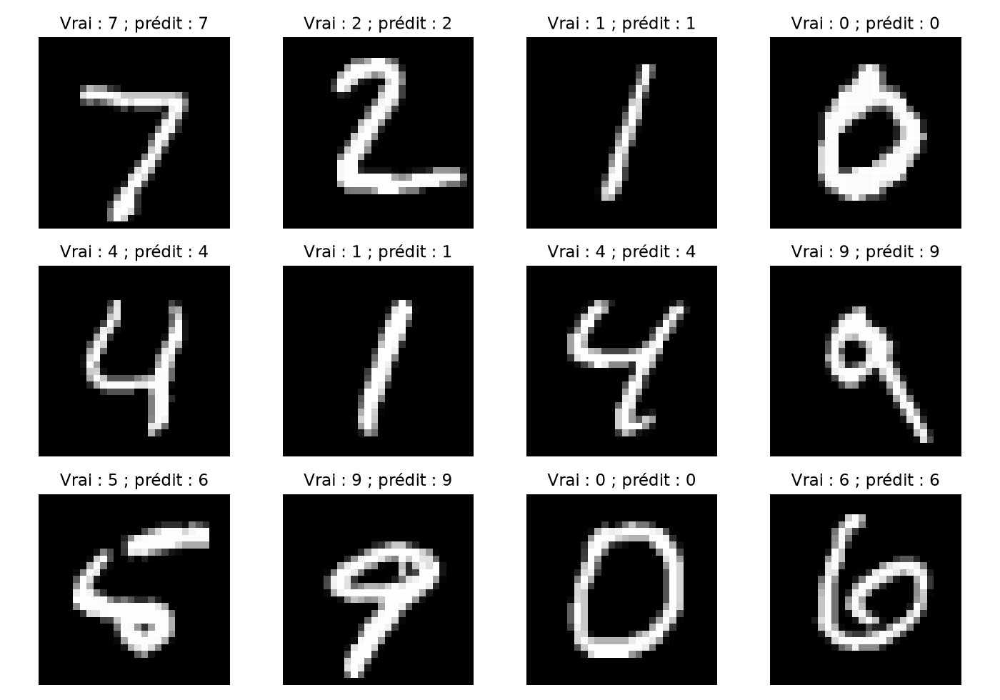

# TP — Classification MNIST avec PyTorch : CNN, Faster R-CNN, VGG16, AlexNet et Vision Transformer

## Introduction

Ce TP compare un CNN et un Vision Transformer appris de zéro, deux réseaux ImageNet adaptés par transfert et Faster R-CNN adapté à la détection d'un chiffre. Les cinq scripts sont indépendants et structurés en onze cellules exécutables `# %%`, avec commentaires et visualisations en français.

## Dataset MNIST

`torchvision.datasets.MNIST` télécharge les vraies images : 60 000 exemples officiels d'apprentissage et 10 000 de test. Un découpage `random_split`, générateur de graine 42, fournit **50 000 images d'entraînement, 10 000 de validation et 10 000 de test**. L'empreinte SHA-256 des indices d'entraînement est enregistrée pour vérifier l'identité du découpage. Le test reste réservé à l'évaluation finale ; le nombre d'époques est fixé à l'avance, sans recherche d'hyperparamètres sur le test.

CNN et ViT utilisent les images 28×28 et la normalisation MNIST (moyenne 0,1307 ; écart-type 0,3081). VGG16 et AlexNet utilisent une conversion en trois canaux, un redimensionnement à **64×64** et la normalisation ImageNet. Cette résolution, compatible avec leur pooling adaptatif, limite le calcul et la mémoire ; elle diffère du prétraitement ImageNet habituel et peut réduire la qualité du transfert. Aucune augmentation aléatoire n'est appliquée.

## Environnement

L'installation est isolée dans `.venv` à la racine du workspace. Le contrôle initial dans le bac à sable ne voyait pas CUDA ; `nvidia-smi` exécuté avec accès matériel confirme une **NVIDIA GeForce RTX 3050 Laptop, 4 Go**, pilote 610.57.04. Les entraînements doivent être lancés avec les permissions d'accès au GPU. Les versions réellement utilisées et le pic de mémoire allouée par PyTorch figurent dans chaque JSON. Ce pic ne comprend pas la mémoire du bureau ni toutes les allocations du pilote.

Les graines Python, NumPy et PyTorch valent 42 ; cuDNN utilise des algorithmes déterministes et désactive le benchmark. Cela facilite la reproduction sans garantir une identité bit à bit entre matériels ou versions. Les lots utilisent zéro processus auxiliaire, le transfert épinglé sur GPU et la précision mixte CUDA avec `GradScaler`. L'évaluation des classifieurs utilise `inference_mode()` et la précision mixte ; celle du détecteur conserve la précision simple pour les boîtes.

## Partie 1 — CNN et modèles pré-entraînés

| Modèle | Architecture et stratégie | Lot | Époques | Optimisation |
|---|---|---:|---:|---|
| CNN | Convolutions 1→32→64, ReLU, deux max-pools, dense 128, dropout 0,3, sortie 10 | 128 | 5 | AdamW, lr 0,001, décroissance 0,0001 |
| Faster R-CNN | Backbone 3→32→64 appris de zéro, RPN, ROI Align 3×3, tête 128, 11 classes | 16 | 3 | AdamW, lr 0,001, décroissance 0,0001 |
| VGG16 | Poids ImageNet, convolutions gelées, classifieur dense entraîné, dernière couche 4096→10 | 16 | 3 | SGD, lr 0,001, momentum 0,9, décroissance 0,0001 |
| AlexNet | Poids ImageNet, convolutions gelées, classifieur dense entraîné, dernière couche 4096→10 | 32 | 3 | SGD, lr 0,001, momentum 0,9, décroissance 0,0001 |
| ViT | Patches 7×7, dimension 64, quatre têtes et quatre blocs | 128 | 8 | AdamW, lr 0,001, décroissance 0,0001 |

Le CNN emploie des noyaux 3×3, un pas de 1 et un padding de 1. Les max-pools 2×2 de pas 2 réduisent 28→14→7. Dropout et décroissance des poids régularisent le classifieur ; l'entropie croisée apprend les dix classes.

**Faster R-CNN.** Chaque boîte englobe tous les pixels strictement positifs du chiffre ; les bornes maximales sont exclusives et les images vides provoquent une erreur explicite. Le fond a le label 0, les chiffres 0–9 ont les labels 1–10. Le backbone réduit la résolution d'un facteur quatre. Le RPN propose des régions à partir d'ancres de tailles 8, 16, 24 et 32, de rapports 0,5, 1 et 2. ROI Align transforme chaque proposition en grille 3×3 ; deux couches denses prédisent sa classe et la correction des coordonnées. Les propositions sont limitées pour tenir dans 4 Go.

La prédiction image est le chiffre de la détection de confiance maximale, après le filtrage interne au seuil 0,05 et la suppression non maximale. Une absence reçoit la prédiction −1, compte comme erreur et comme faux négatif de sa classe ; une colonne spécifique apparaît dans la matrice de confusion. La précision, le rappel et le F1 macro portent sur les dix chiffres. La perte est la somme classification ROI + régression ROI + objectivité RPN + régression RPN. Sa validation nécessite le mode `train()` de Torchvision avec `no_grad()` ; ce petit modèle n'a ni BatchNorm ni dropout. Les tirages de propositions de validation sont isolés de l'état aléatoire d'apprentissage. L'exactitude de validation provient ensuite d'une véritable inférence en mode `eval()`.

L'IoU moyenne de la meilleure détection (zéro si absente) et la proportion « classe correcte ET IoU ≥ 0,5 » sont fournies séparément. Ce ne sont pas des mAP COCO. La vérité de localisation étant générée automatiquement à partir des pixels, ce protocole mesure un problème de détection adapté, **pas exactement la même tâche** que les quatre classifieurs.

**VGG16 et AlexNet.** VGG16 contient treize convolutions 3×3 et trois couches denses ; AlexNet, moins profond, contient cinq convolutions et trois couches denses, avec de grands noyaux et des pas plus élevés au début. Le transfert réutilise les caractéristiques ImageNet. Les convolutions restent gelées pendant toute cette expérience ; les trois couches du classifieur sont entraînées, avec dropout 0,5 et sortie adaptée à dix classes. Un dégel des derniers blocs serait un fine-tuning supplémentaire, qui n'est pas appliqué ici. Les paramètres gelés restent inclus dans le nombre total, mais pas dans le nombre entraînable.

## Partie 2 — Vision Transformer

L'implémentation ne charge aucun ViT pré-entraîné et définit explicitement l'attention. `unfold` extrait **16 patches 7×7**, puis une projection linéaire transforme leurs 49 pixels en vecteurs de dimension 64. Un jeton de classification appris et des embeddings positionnels appris donnent une séquence de 17 jetons.

Chaque bloc applique LayerNorm, attention multi-têtes Q/K/V à quatre têtes, connexion résiduelle, puis LayerNorm et MLP 64→128→64 avec GELU, dropout 0,1 et seconde connexion résiduelle. Le softmax des scores d'attention est calculé en float32. Après quatre blocs, LayerNorm et une couche 64→10 classent le jeton de classe. La convolution exploite un voisinage local et le partage spatial des filtres ; l'auto-attention apprend des interactions entre tous les patches dès chaque bloc, avec moins de biais de localité.

## Résultats expérimentaux

Les cinq expériences ont été exécutées intégralement sur la RTX 3050, dans l’ordre CNN → Faster R-CNN → VGG16 → AlexNet → ViT. Chaque modèle a parcouru les 50 000 images à chaque époque puis les 10 000 images de test. Exécution au terminal, de la première à la dernière cellule ; backend Matplotlib `Agg` pour sauvegarder les figures dans cette session sans interface graphique. Les mêmes fonctions affichent les figures dans une session interactive.

Environnement effectivement utilisé : **Python 3.14.7, PyTorch 2.15.0+cu132, Torchvision 0.29.2+cu132, CUDA 13.2**, RTX 3050 Laptop GPU. La vérification `pip check` ne signale aucune dépendance cassée.

| Modèle | Accuracy test | F1-score macro | Loss validation finale | Temps d’entraînement |
|---|---:|---:|---:|---:|
| CNN | 99.07 % | 0.99065 | 0.03670 | 42.84 s |
| Faster R-CNN | 98.67 % | 0.98661 | 0.22014 | 594.04 s |
| VGG16 | 96.87 % | 0.96843 | 0.10069 | 567.67 s |
| AlexNet | 94.62 % | 0.94543 | 0.16696 | 150.49 s |
| ViT | 97.16 % | 0.97134 | 0.10508 | 78.44 s |

**Définition des mesures.** La loss du tableau est la moyenne de validation à la dernière époque : entropie croisée pour les quatre classifieurs, somme des quatre pertes de détection pour Faster R-CNN. Ces pertes ne sont donc pas directement comparables entre tâches. Les temps utilisent `time.perf_counter()` et une synchronisation CUDA avant et après ; ils comprennent les boucles d’entraînement **et la validation à chaque époque**, mais excluent téléchargements, initialisation, test et export des figures. Les budgets d’époques et de lots diffèrent : ces temps décrivent les configurations exécutées, pas une comparaison à budget de calcul égal.

| Modèle | Précision macro test | Rappel macro test | Loss entraînement finale | Loss test classification |
|---|---:|---:|---:|---:|
| CNN | 0.99070 | 0.99063 | 0.03105 | 0.02832 |
| Faster R-CNN | 0.98675 | 0.98654 | 0.22549 | Sans objet (détection) |
| VGG16 | 0.96881 | 0.96834 | 0.13195 | 0.09796 |
| AlexNet | 0.94669 | 0.94517 | 0.23899 | 0.16043 |
| ViT | 0.97165 | 0.97131 | 0.07193 | 0.09507 |

| Modèle | Paramètres totaux | Paramètres entraînables | Pic alloué GPU (MiB) |
|---|---:|---:|---:|
| CNN | 421,642 | 421,642 | 36.6 |
| Faster R-CNN | 157,683 | 157,683 | 15.9 |
| VGG16 | 134,301,514 | 119,586,826 | 1882.5 |
| AlexNet | 57,044,810 | 54,575,114 | 843.7 |
| ViT | 139,018 | 139,018 | 32.3 |

**Localisation Faster R-CNN.** Aucune détection absente sur 10,000 images ; IoU moyenne de la détection la plus confiante : **0.91655** ; classe correcte et IoU ≥ 0,5 : **98.64 %**. Les absences restent gérées dans le code, y compris dans la matrice de confusion.

**Incidents corrigés.** Faster R-CNN a échoué avant son premier lot parce que la vue trois canaux créée par `expand` avait des éléments mémoire partagés ; `.contiguous()` a résolu le transfert en mémoire épinglée et l’expérience a été relancée intégralement. Un premier essai VGG16 avec SGD à 0,01 a donné une validation proche du hasard après une époque (12,87 %, loss 2,29943). Il a été interrompu, puis le modèle réinitialisé depuis ImageNet et entraîné trois époques à 0,001. AlexNet utilise également 0,001, fixé avant son entraînement. Le test n’a pas servi à ce choix. Le journal interrompu `metrics/VGG16_lr001_interrompu.log` est conservé ; son coût n’entre pas dans le temps du run final. Les avertissements Matplotlib `FigureCanvasAgg` reflètent uniquement l’absence de fenêtre graphique ; les PNG ont bien été créés.

**Traçabilité.** Les JSON contiennent les valeurs non arrondies, les historiques complets, les effectifs, les versions, les paramètres et les matrices de confusion. Leurs valeurs imprimées concordent avec les journaux. L’empreinte commune du découpage est :

```text
a448c5b6b20079fc657a6c5eee8ec6b22bdd1f0c1e76c9655deb217485cf2bb5
```

### Figures générées

#### CNN




[Exploration du dataset](figures/CNN/donnees.png) · [Métriques JSON](metrics/CNN.json) · [Journal d’exécution](metrics/CNN.log)

#### Faster R-CNN







[Exploration du dataset](figures/Faster_RCNN/donnees.png) · [Métriques JSON](metrics/Faster_RCNN.json) · [Journal d’exécution](metrics/Faster_RCNN.log)

#### VGG16






[Exploration du dataset](figures/VGG16/donnees.png) · [Métriques JSON](metrics/VGG16.json) · [Journal d’exécution](metrics/VGG16.log)

#### AlexNet






[Exploration du dataset](figures/AlexNet/donnees.png) · [Métriques JSON](metrics/AlexNet.json) · [Journal d’exécution](metrics/AlexNet.log)

#### ViT






[Exploration du dataset](figures/ViT/donnees.png) · [Métriques JSON](metrics/ViT.json) · [Journal d’exécution](metrics/ViT.log)

## Discussion

Le CNN obtient la meilleure accuracy (99,07 %) et le meilleur F1 macro (0,99065), avec seulement 421 642 paramètres et le temps le plus court (42,84 s). Ses filtres locaux et ses réductions spatiales conviennent bien aux petits chiffres centrés. Sur cette exécution, il fournit le meilleur compromis précision, temps et taille.

Faster R-CNN atteint 98,67 % avec un petit backbone, mais demande 594,04 s : le RPN, le traitement des propositions et les passes de validation supplémentaires ajoutent du travail malgré peu de paramètres. La qualité de localisation est élevée, mais elle dépend de boîtes automatiquement générées et d’un seul objet par image. Cette complexité est peu justifiée pour la seule classification MNIST, tout en illustrant une véritable chaîne de détection.

Le transfert ImageNet n’est pas automatiquement supérieur : VGG16 atteint 96,87 % et AlexNet 94,62 %. Les caractéristiques gelées viennent de photographies naturelles en couleur ; le changement de domaine, l’entrée réduite à 64×64 et le court entraînement des classifieurs limitent vraisemblablement le transfert. Ces explications sont des hypothèses cohérentes avec le protocole, pas des causes isolées par ablation. VGG16 entraîne davantage de paramètres et prend 567,67 s, contre 150,49 s pour AlexNet. Un dégel partiel et une résolution plus élevée mériteraient une nouvelle expérience fondée sur la validation.

Le ViT atteint 97,16 % avec 139 018 paramètres en 78,44 s pour huit époques. Il reste derrière le CNN malgré un budget d’époques supérieur ; cela illustre, dans cette configuration, l’intérêt du biais de localité des convolutions. Ce résultat ne permet pas de conclure que les Transformers sont généralement inférieurs aux CNN : taille du modèle, données, entraînement et résolution influencent fortement le classement.

Les cinq configurations tiennent dans la RTX 3050 4 Go. Le pic alloué PyTorch le plus élevé est celui de VGG16 (environ 1 883 MiB) ; les gros classifieurs denses, gradients et états de momentum dominent sa mémoire. Le gel du backbone et la précision mixte permettent cette exécution. Les pics mesurés excluent notamment le bureau graphique, le cache réservé et une partie du contexte CUDA. Une seule graine et un seul run final par configuration ont été mesurés : aucune incertitude statistique ni stabilité entre graines n’est évaluée.

## Conclusion

Le **CNN appris de zéro est le meilleur modèle mesuré** pour ce protocole MNIST : 99,07 % d’accuracy, F1 macro 0,99065 et 42,84 s. Faster R-CNN réussit l’adaptation en détection, mais son coût et sa tâche supplémentaire rendent sa comparaison moins directe. Le ViT démontre une attention apprise sans poids pré-entraînés ; les deux modèles ImageNet montrent à la fois les possibilités et les limites du transfert avec caractéristiques gelées.

## Synthèse personnelle

Je retiens qu’un modèle adapté à la structure des données peut surpasser un réseau beaucoup plus grand. Construire le CNN permet de relier filtres, pooling, dropout et apprentissage supervisé. L’exécution CUDA montre l’importance de vérifier les permissions, la précision mixte, la taille des lots et le chronométrage synchronisé. Faster R-CNN oblige à distinguer classification et localisation, à produire des annotations valides et à gérer le fond et les absences. Le transfert nécessite un prétraitement cohérent, un gel explicite et un taux d’apprentissage prudent. Le ViT rend concret le passage des pixels aux patches puis aux interactions d’attention. Enfin, comparer des architectures exige le même découpage, un test préservé et des mesures réelles dont les limites sont expliquées.

## Exécution

Depuis la racine du workspace :

```bash
python -m venv .venv
source .venv/bin/activate
python -m pip install -r TP_PyTorch/requirements.txt
python TP_PyTorch/01_CNN.py
python TP_PyTorch/02_Faster_RCNN.py
python TP_PyTorch/03_VGG16.py
python TP_PyTorch/04_AlexNet.py
python TP_PyTorch/05_ViT.py
```

Installer PyTorch et Torchvision ensemble ; si un environnement CUDA compatible fonctionne déjà, le conserver et installer seulement les dépendances manquantes. Vérifier `torch.cuda.is_available()` et `nvidia-smi` avant l'entraînement. Les scripts annoncent explicitement un éventuel repli CPU. Pour une exécution sans écran, ajouter `MPLBACKEND=Agg` devant chaque commande ; les figures sont alors enregistrées sans fenêtre graphique.

Dans VS Code, sélectionner l'interpréteur `.venv/bin/python`, ouvrir un script et utiliser **Run Cell** au-dessus du premier `# %%`, puis poursuivre les onze cellules dans l'ordre. Éviter de lancer plusieurs entraînements simultanément. Chaque script s'exécute aussi intégralement au terminal. Les téléchargements sont réutilisés dans `data/`, les PNG dans `figures/<modèle>/` et les métriques dans `metrics/`. Les métriques enregistrent toutes les époques et la matrice de confusion ; aucun poids final n'est sauvegardé automatiquement.

## Références

- [MNIST, référence du sujet sur Kaggle](https://www.kaggle.com/datasets/hojjatk/mnist-dataset).
- [Torchvision MNIST : téléchargement du dataset officiel](https://docs.pytorch.org/vision/stable/generated/torchvision.datasets.MNIST.html).
- [Brian Pulfer — Vision Transformers from Scratch](https://medium.com/mlearning-ai/vision-transformers-from-scratch-pytorch-a-step-by-step-guide-96c3313c2e0c), référence conceptuelle ; notre configuration utilise des patches de 7 pixels, à distinguer du nombre de patches par axe du tutoriel.
- [Torchvision Faster R-CNN](https://docs.pytorch.org/vision/main/_modules/torchvision/models/detection/faster_rcnn.html).
- [Torchvision VGG16](https://docs.pytorch.org/vision/main/models/generated/torchvision.models.vgg16.html) et [code AlexNet](https://github.com/pytorch/vision/blob/main/torchvision/models/alexnet.py).
